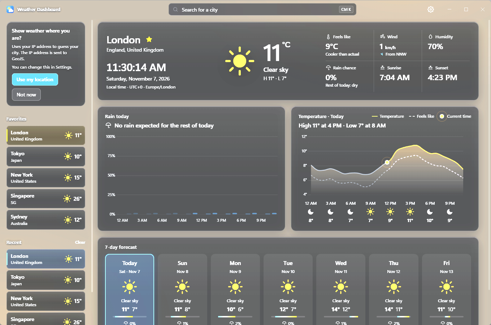
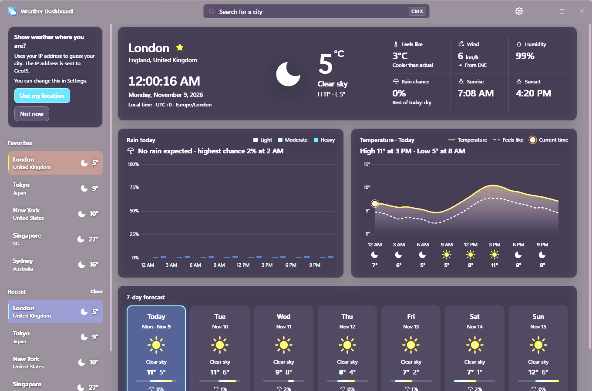
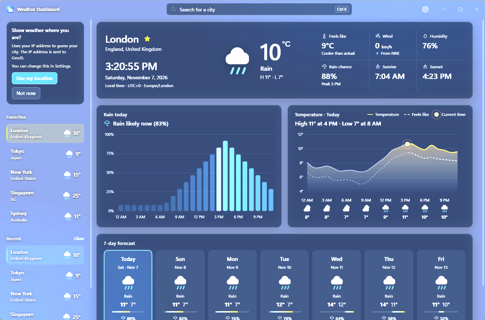
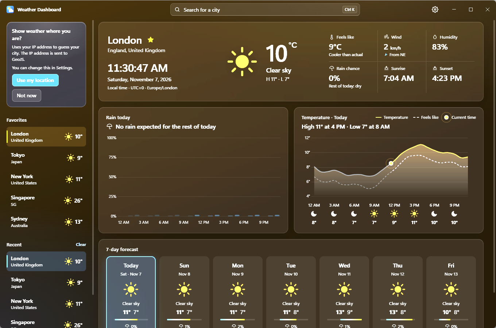
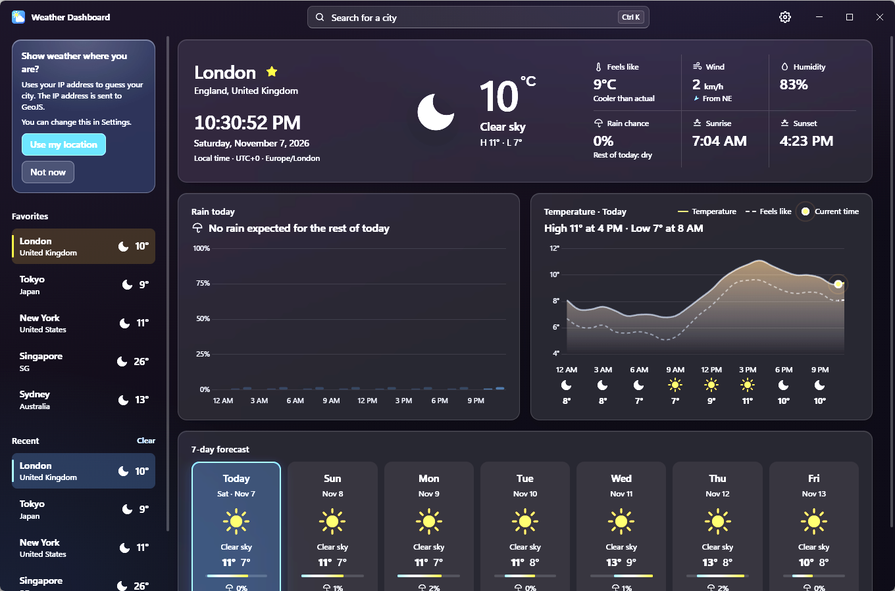
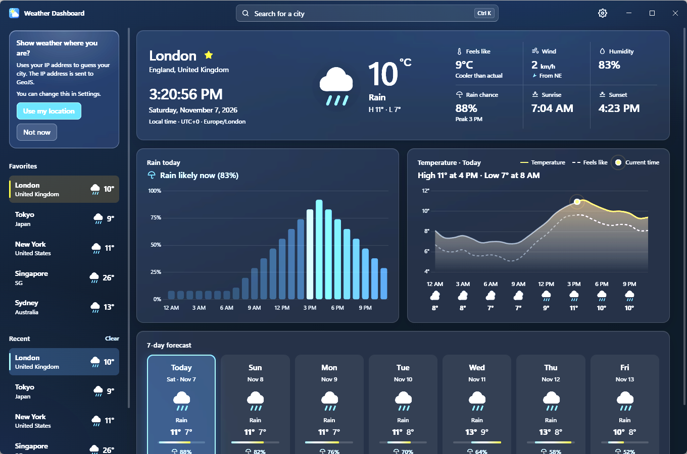

<div align="center">

# 🌦️ Weather Dashboard

**A dark, modern Windows desktop weather app: live conditions, a 7-day forecast, rain and temperature charts, and favorite cities. Built with Electron, Express and TypeScript.**


|  |  |  |
|:---:|:---:|:---:|
| Glass look: clear day | Glass look: night | Glass look: rain |
|  |  |  |
| Classic look: clear day | Classic look: night | Classic look: rain |

<sub>Staged scenes: the screenshot script sets the weather and the time of day, so they do not show live weather (temperatures and wind are real). Same window size for all six. Taken over a flat grey backdrop, which shows through only in the glass look.</sub>

</div>

---

## Install

1. Download `Weather-Dashboard-Setup-<version>.exe` from the [latest release](https://github.com/MooreHaww/weather-dashboard/releases/latest).
2. Windows may say **"Windows protected your PC"** because the installer is not code-signed. Click **More info**, then **Run anyway**.
3. Pick an install folder. You get Start Menu and desktop shortcuts.

No Node.js needed. Installed copies (1.4.0 and later) update themselves from the GitHub releases.

## 💡 Why this project exists

Most weather apps are cluttered, full of ads, or need an account. I wanted one clean window that answers the questions I actually have: what is it like now, will it rain today, and what does the week look like, for any city I care about.

It is also **project #2** of my build plan. The goal was to ship something real: not a script, but an app that installs on another person's PC, updates itself, works offline, and has tests.

## 🔎 What it does

- **Current conditions:** temperature, feels like, wind, humidity, rain chance, sunrise and sunset.
- **Live local clock** for the selected city, using that city's own timezone (for example `UTC+5:45` for Kathmandu).
- **7-day forecast:** click a day (or use ←/→) and the rain and temperature charts switch to it.
- **Rain chart** with a one-line summary such as *"70% chance of light rain around 4 PM · about 1.2 mm"* (or *"16:00"* in 24-hour mode). The bars show the chance per hour, coloured by the amount: light, moderate or heavy.
- **Temperature chart** with a dashed feels-like line and an hourly icon strip.
- **City search** with keyboard shortcuts (`Ctrl+K` or `/`).
- **Favorites and recent cities**, shown as cards with live weather. Recent cities can be cleared.
- **Settings panel (v1.2):** a full-window liquid-glass panel with temperature (°C/°F) and wind-speed units (km/h, mph, m/s) and a 12-hour or 24-hour clock that updates everywhere at once.
- **Live data and chart (v1.3):** refreshes itself every 5 minutes with no flicker, and the temperature chart covers the whole day (12 AM to 11 PM in the city's own time): hours that have passed are grey, the rest is coloured, and a pulsing dot marks the current time ("Current time" in the legend). The hourly strip is evenly spaced and can show every 3 hours, every 2 hours or every hour.
- **Auto-update (v1.4):** checks GitHub Releases 10 seconds after start and then every 4 hours, downloads a new version in the background and installs it when you close the app.
- **Update now (v1.4.6):** when an update is ready, the gear shows a red dot and Settings has an **Update now** button. After you confirm, the app closes, updates and opens again.
- **v1.4.5:** remembers the window's size, position and maximized state; `F5` or `Ctrl+R` refreshes.
- **Updates in Settings (v1.4.7):** the **Updates** section always shows the app version and where updating stands: up to date (and when it was last checked), downloading, or ready with the **Update now** button.
- **Your location (v1.5):** the first time, a card asks whether the app may guess your city from your IP address. Nothing is looked up until you say yes. If you do, **Your location** stays on top of the sidebar (it is not a favorite and not a recent search) and, on a first start, it is the city shown. **Not now** is remembered, and the switch in Settings changes either answer.
- **Check for updates (v1.5):** a button in the Updates section of Settings, for when you do not want to wait for the automatic check.
- **Liquid glass look (v1.6):** on Windows 11 22H2 or newer the outer area of the window is Windows' acrylic glass, so what is behind the window shows through, blurred. It is tinted by the weather and the time of day of the shown city (nine weather groups and six times of day: morning, noon, afternoon, sunset, dusk and night, from the city's own sunrise and sunset). The boxes are translucent dark frosted glass and look the same in every weather. Where the effect is not available, the app keeps the plain dark look.
- **Choose the look (v1.7):** **Settings > Look** switches between **Classic** and **Glass** at once, with no restart. The classic look now changes with the weather and the time of day too: the same weather groups and times of day as the glass tint, each with its own opaque dark background. New installs start in Classic; people who update from 1.6 keep Glass. Glass shows only where Windows can draw it; elsewhere the Glass option is disabled and its **i** button says what it needs.
- **Works at any window size**, down to 480×400.
- **Offline-friendly:** if the internet drops, it shows the last data it fetched and says so.
- **Accessible:** every chart has a screen-reader data table.

Weather data comes from [Open-Meteo](https://open-meteo.com/), which is free and needs no API key.

### 📊 Measured result: the cache really helps

`npm run bench` replays one realistic session (38 requests) against live Open-Meteo. Measured on 2026-10-24:

| | Requests | Median | 95th percentile |
|---|---:|---:|---:|
| Served from cache | 23 | **0.6 ms** | 1.5 ms |
| Fetched from Open-Meteo | 15 | 48.1 ms | 210.8 ms |

**Cache hit rate: 60.5%.** A cached answer is about **79× faster**. Your numbers will vary with your network.

## ⚙️ Setup

### Want to run it from the code?

You need **Node.js 22 LTS**.

```bash
git clone https://github.com/MooreHaww/weather-dashboard.git
cd weather-dashboard
npm install
npm run dev
```

| Command | What it does |
|---|---|
| `npm run dev` | Vite (hot reload) + Electron |
| `npm run dev:server` | API + Vite only, open `http://127.0.0.1:5173` in a browser |
| `npm test` | Unit and API tests (584 tests, no internet needed) |
| `npm run test:e2e` | Launches the real app and checks the UI (232 tests, needs internet) |
| `npm run test:update` | Builds the installer, then checks auto-update and "Update now" in the packaged app against a local test feed (11 tests) |
| `npm run lint` | ESLint and type-check |
| `npm run bench` | Cache hit rate and response times |
| `npm run dist` | Builds the Windows installer |

There are no secrets anywhere. Copy `.env.example` to `.env` only if you want to change the dev port or cache times.

## 🎯 What I wanted to learn

- How to build a **desktop app with Electron** and package it into a real installer.
- How to put a small **Express server inside the app** so the UI talks to a clean local API.
- How to write a **cache** (10-minute TTL for weather, 24 hours for city search) and prove it with numbers instead of guessing.
- How to deal with **time zones** properly: the clock must follow the city, not my PC.
- How to **test a GUI app end to end**, including checking that the charts actually drew pixels.
- How to make an Electron app **secure** and **accessible**.
- Why a **local JSON file** beats a cloud database for an app that other people install.

## What I learned

- **Library defaults are objects you change, not replace.** I assigned a new object to `Chart.defaults.animation`. That broke Chart.js animations ("this._fn is not a function") and left both charts empty. Setting single fields fixed it.
- **A test setting can hide a bug.** The end-to-end tests once forced reduced motion, so the animation bug above never showed up in them. They now run with animations on and count the pixels each chart painted.
- **`min-height` on a flex child changes how it shrinks.** An explicit `min-height` replaced flexbox's "not smaller than the content" rule. The top card got squeezed and cards overlapped when the window was resized or docked. Now there are no fixed heights and one scroll container.
- **Drag regions ignore what is drawn on top.** The title bar is a window drag region, and Electron combines drag and no-drag areas regardless of what is drawn over them. Every clickable thing in the title bar needs `no-drag`.
- **File names must survive the upload.** GitHub renames uploaded files with spaces, so 1.3.0's `latest.yml` named an installer file that did not exist on the release. The installer name now has no spaces, and `npm run release-files` checks that `latest.yml` and the files agree.
- **A cache changes what "refresh" means.** Weather is cached for 10 minutes, so a 5-minute refresh would have been answered from the cache. The refresh and the Refresh button now ask the server to skip the cache, and the answer still refills it.
- **"Loading" and "showing" are two different cities.** When a city failed to load, the next redraw put the new city's name over the old city's weather and clock, and the star saved the wrong city. The app now keeps track of the city being loaded and the city on screen separately.

## ⚙️ Settings panel

The gear in the title bar opens a liquid-glass panel that covers the whole window: the dashboard behind it is blurred and darkened, so its text cannot be read through the panel. In the glass look the app name and the search box are hidden while it is open. `Esc`, the close button (in the gear's spot) or the gear itself closes it, and keyboard focus stays inside while it is open. Its content scrolls when the window is short. With "reduce animations" on in Windows it fades instead of sliding. Since 1.5.1 it shows only section titles and controls, plus the lines that say where things stand (updates, location); the longer explanations are still read out by screen readers.

| Section | Options |
|---|---|
| **Updates** | Always first. The installed version and the state: "Version 1.5.1 · Up to date · checked 10:42" after a check that found nothing newer (the time follows the 12/24-hour setting), "Version X is downloading…", or "Version X is ready" with **Update now**. It asks "Restart now?" first; **Later** or `Esc` changes nothing, and the update still installs when the app quits (**Exit**, or **Quit** in the tray; closing a window that keeps running in the tray is not quitting). Before the first check, in a build that does not update itself, or after a failed check ("Couldn't check for updates") it shows only the version, never "Up to date". **Check for updates** is there when the app can update itself (before the first check, up to date, or after a failed check); it says "Checking…" while it runs, and a second press within 30 seconds is ignored |
| **Look** | **Classic** or **Glass**, applied at once. Classic is an opaque dark page whose colour follows the weather and the time of day; Glass is Windows' acrylic glass. Glass is disabled where Windows cannot draw it (older than Windows 11 22H2, "Transparency effects" off, high contrast or reduced transparency); the **i** button next to it says "Glass needs Windows 11 22H2 or newer with Transparency effects on." If glass becomes possible later (for example, transparency effects turned back on), a saved Glass choice applies without a restart |
| **Background** | **When I close the window**: **Ask** (default), **Keep running** or **Exit**. Ask shows "Close Weather Dashboard?" with **Keep running** and **Exit** and a **Remember my choice** box; `Esc` keeps the window open. Keep running hides the window and the app stays in the tray (left click or **Open Weather Dashboard** brings it back; **Quit** ends it). Exit quits as before 1.9. **Start with Windows**: a switch that shows what Windows says right now (it is read again each time Settings opens, since you can also change it in Windows Settings > Apps > Startup); started this way, the app opens hidden in the tray. It works only in the installed app; elsewhere it is off and disabled, and its **i** button says why. **Rain alerts**: off until you turn it on; **Send a test** shows a test notification. Its **i** button says which city is used and that Windows can block notifications |
| **Units** | Temperature °C / °F, wind speed km/h / mph / m/s |
| **Time format** | 12-hour or 24-hour, shown with examples from the current time (for example "12-hour (4:00 PM)" and "24-hour (16:00)"); used by the live clock, hourly strip, chart labels, sunrise and sunset, and the rain line |
| **Temperature chart** | Time labels under the temperature chart: every 3 hours (default), every 2 hours, or every hour. A narrow card shows fewer, evenly spaced |
| **Location** | **Use my location** switch. It is off until you answer the card in the sidebar. On: the app asks GeoJS for your city (by IP address, at each start) and says "Near Paris, France. This is approximate."; if it cannot, "Couldn't find your location. It tries again the next time the app starts." Off: no lookup is made and the stored place is deleted. The section says what is sent: "Uses your IP address, sent to GeoJS." The **i** button next to the switch opens "How your IP address is used", the same text as under [Privacy](#privacy); `Esc` or a click outside closes it and leaves Settings open |

Settings are saved in the local JSON file and checked by the server; older files without the new fields load with the defaults (12-hour, km/h, every 3 hours, location not answered yet, so nothing is looked up). The look is decided once, the first time 1.7 reads the file, and saved straight away: no file (a new install) gives Classic, a file without the field (an update from 1.6 or older) gives Glass. Sections are plain data in `SETTINGS_SECTIONS` (`src/renderer/components/settings.ts`), built with `settingsRow` and `segmentedControl`. Later releases add their own sections (widget) the same way. The close choice and rain alerts are saved like the other settings (files from 1.7.1 and older load with Ask and alerts off); Start with Windows is not saved by the app at all, because Windows' own startup entry is the only record. The Updates section is built with the same helpers in `src/renderer/components/updateNote.ts` and is added at the top. It only displays the state the main process sends it (`src/main/updateTracker.ts`); the page cannot set it. Every time on screen goes through one function, `formatTime` in `src/shared/time.ts`.

## 🏗️ How it was built

```text
Electron main process
 ├─ starts Express on 127.0.0.1 (random free port, never reachable from the network)
 │    ├─ /api/geocode   → Open-Meteo geocoding   (cached 24 h)
 │    ├─ /api/weather   → Open-Meteo forecast    (cached 10 min)
 │    ├─ /api/state, /api/favorites, /api/recent, /api/settings
 │    ├─ /api/location  → GeoJS, only after you allowed it (one request, no retry)
 │    ├─ /api/stats     → cache hit rate and response times
 │    └─ the built UI
 ├─ the window loads http://127.0.0.1:<port>
 ├─ decides glass or solid (Windows version, "Transparency effects", high contrast, reduced transparency)
 │    └─ glass: the window gets Windows' acrylic material; the page is told "glass" or "solid" (receive-only)
 └─ electron-updater checks GitHub Releases (installed app only)
      └─ preload: "update ready" and the update state to the page; "Update now" and "Check for updates" back (the page's only two messages)
```

| Folder | Purpose |
|---|---|
| `src/main/` | Electron entry: starts the server, opens a hardened window, auto-update, window size and position |
| `src/server/` | Express app, cache, Open-Meteo client, JSON storage, routes |
| `src/shared/` | Types, weather codes, time helpers (used by server and UI) |
| `src/renderer/` | The UI: HTML/CSS, components, Chart.js charts, SVG icons |
| `tests/` | Vitest unit/API tests, the end-to-end tests and the packaged-app update test |
| `scripts/` | App launcher for tests, screen capture over a controlled backdrop, benchmark, screenshot, icon and release-file tools |

**Key decisions**

- **Local JSON file, not MongoDB Atlas.** A cloud database needs a connection string, and anyone can unpack an Electron app and read it. It would also send each user's private data to a shared database and need internet just to show favorites. A local file needs no account, works offline and uninstalls cleanly. Writes are atomic, so a crash cannot leave a half-written file.
- **Security.** The window runs sandboxed with context isolation and no Node access. A strict Content Security Policy blocks outside scripts. The server only answers requests addressed to `127.0.0.1` or `localhost` (this blocks DNS-rebinding attacks). All API text is HTML-escaped. The page can send two messages to the main process, both with no arguments. "Update now" is ignored unless an update has been downloaded; "Check for updates" is ignored in a build that does not update itself, while an update is downloading or ready, while a check runs, and within 30 seconds of the last one. Both are ignored unless they come from the app's own window and top frame, loaded from the local server.
- **Location by IP, in the server, behind a switch.** The lookup runs in the local Express server, not in the page, so the page's Content Security Policy did not change. The server refuses it unless the saved setting says you allowed it (the page cannot skip that), makes one plain request (no cookies, no identifiers, a generic `User-Agent`, 5 seconds, no retry, no redirects), keeps only the city, country, coordinates rounded to about 1 km and the timezone from the answer after checking each, and never stores or logs the IP address. The detected place has its own id (-1) so it can never end up in favorites, recent cities or the next start's city.
- **Glass (v1.6): Windows draws it, the page only tints it.** The window uses Electron's `backgroundMaterial: 'acrylic'` with a fully transparent window colour (not `transparent: true`: a fully transparent window was tried and lost double-click maximize, Win+arrow snapping, the snap layouts, rounded corners and the shadow). Acrylic was chosen over mica because it blurs whatever is behind the window, live; mica only samples the desktop wallpaper. The main process decides at start (and again when Windows' accessibility settings change, or when the window gets focus) and tells the page "glass" or "solid"; the page can only listen. Over the glass the page draws only a light wash in the colour of the weather and the time of day (alpha 0.08 to 0.34; one constant, `WASH_STRENGTH` in `src/shared/sky.ts`, sets how strong it is). Only fog whitens the glass. The boxes have a flat dark fill of 0.65 with blur, a thin light edge and an inner glow, the same in every weather (a soft gradient on top of each box was removed in 1.6.1: Chromium dithers gradients, and that was the fine shimmer over the boxes). The sidebar's Your location, Favorites and Recent lists are plain rows on the bare glass, as in the plain look, not boxes. Contrast rule for everything on a box: main text and numbers 4.5:1 over a mid-grey and a dark desktop and 3:1 over white; secondary text and graphics 3:1 over grey and dark. Windows' own acrylic tint is not counted on. Behind the open Settings panel the dashboard is blurred by a CSS `filter` on the dashboard itself: the panel's `backdrop-filter` left the dashboard text sharp over the see-through page.
- **Look choice (v1.7) without a new message.** The page decides what it shows: Glass only if you chose it and the main process says Windows can draw it (plus no forced colours and no reduced transparency); otherwise Classic. The window keeps its acrylic material in Classic, covered by the opaque page; turning the material off would need either a new message from the page to the main process or the main process reading the saved setting itself, so it was left as it is. The classic backgrounds were picked by a small search script and are checked by an offline test: every text 4.5:1 and every graphic 3:1 on all 18 backgrounds, and every two backgrounds at least ΔE 5 apart. That raised the muted text from 62 % to 78 % white and gave text links a lighter blue (#93c5fd); the old clear-day theme's muted text was 3.6:1. The classic Settings panel got a dark layer under a lighter tint and sheen, and solid muted text, so its text is also 4.5:1 on every background (before: 3.2:1 for muted text, 4.3:1 for normal text).
- **Cache.** Coordinates are rounded to about 1 km so the same city always reuses one entry, and two identical simultaneous requests share one call to Open-Meteo.

**How it is tested**

- **Unit and API tests** (Vitest) run offline: cache, storage, time and rain helpers, settings, auto-update scheduling, the update state shown in Settings, the "Update now" and "Check for updates" checks in the main process, and the location lookup (what is sent, what is kept, what is refused).
- **End-to-end tests** start the real built app in its own Electron window, with its own profile and a throwaway data folder, and drive it over the Chrome DevTools Protocol with real clicks and key presses. They resize the real window and measure the layout: no overlapping cards, the stat dividers every 50 px from 480 to 1400 px, the hourly strip's spacing, the current-time dot's position. They count the pixels each chart painted and fail on any page error. Animations stay on. The glass tests (v1.6) read the window's material from Windows itself, check that the page is see-through in glass mode and the classic look in the fallback (Windows 10 is simulated), and capture the real screen over a plain grey backdrop window: the weather wash per state, boxes that keep their look in every state, and no sharp dashboard text behind the open Settings panel. A separate offline test computes the contrast of every text and graphic on a box over mid-grey, black, a dark window and white behind the window, under every weather wash. The look tests (v1.7) switch between Classic and Glass, restart the app to check the choice is kept, check that Glass is disabled on a simulated Windows 10, compare the classic background of a sunny and a rainy city, and check that Settings blurs the dashboard in both looks.
- **The update test** builds the installer, runs the packaged app and points its updater at a local fake feed (a `latest.yml` and a fake installer). It checks the Updates section in each state (before the first check, up to date, downloading, ready, and a feed that returns 503), the download, the note, the red dot, "Update now", the restart path and the "Check for updates" button ("Checking…", the result, a second press ignored). The location tests start the app with GeoJS replaced by a fake that counts requests, so the real service is never contacted. The fake installer never runs.

**Releases and auto-update**

1. Bump `version` in `package.json`. It must be higher than the version people have installed, or nothing updates.
2. `npm run dist` builds the installer and checks the release files.
3. Create a GitHub release tagged `vX.Y.Z` (the same version), published (not a draft or prerelease), and upload exactly three files: `Weather-Dashboard-Setup-X.Y.Z.exe`, its `.blockmap` and `latest.yml`.
4. Installed copies find it within 10 seconds of starting or within 4 hours while running, download it and install it when closed, or right away with **Update now**.

**The v1.4.5 code review.** The whole app was reviewed for bugs. A problem only counted once it was reproduced, in the packaged app or in a test. Each fix came with a test that failed before it. Problems that could not be reproduced were written down and left alone, and there were no refactors. See [Code review (v1.4.5)](#code-review-v145).

## Code review (v1.4.5)

**What was reviewed:** the Electron main process, the local server (cache, storage, routes) and the UI.

**Fixed (each with a test that failed first):**

- A city name was shown over another city's weather after a failed load (and the star saved the wrong city).
- Screen readers read the clock every second.
- Keyboard focus was lost after clearing recent cities.

**Left alone:** the hour labels around a daylight-saving change. Open-Meteo labels the whole 7-day forecast with the city's *current* UTC offset, so in the week before a clock change, the hours after the change are one hour off. It corrects itself at the first refresh after the change. A real fix would give those days 23 or 25 hours and break the strip's even spacing, so it is not a small change.

## Privacy

- No account, no sign-in, no analytics.
- Favorites, recent cities, settings and (if you allowed it) the place found by the location lookup are saved in `%APPDATA%\Weather Dashboard\weather-dashboard.json`, and the window size and position in `window-state.json` next to it. Uninstalling keeps them; you can delete the folder.
- The app connects to up to three services:
  - **Open-Meteo**, for the forecast (the coordinates of the city on screen and of your favorite and recent cities) and for city search (what you type in the search box);
  - **GitHub**, to check this repository's releases for updates and download them (installed app only);
  - **GeoJS**, only after you answer "Use my location" with yes and while the switch is on: `https://get.geojs.io/v1/ip/geo.json` (below).
- The window itself can only talk to the app's own local server. Links you click open in your browser.
- Running in the background (1.9) adds no new service. The tray temperature and the rain alerts use the same Open-Meteo forecast request the window makes, through the same 10-minute cache, for one city: Your location if it is on, else your first favorite, else the last city you viewed. The IP-based lookup is still made only while "Use my location" is on.
- Rain alerts are Windows notifications made on this PC; nothing is sent anywhere to show them. They are off until you turn them on.
- **Start with Windows** adds the app to Windows' own list of startup apps (for your user only), with one argument that makes it start hidden in the tray. Turning it off removes the entry. The app keeps no copy of this setting.

The text below is the same one the **i** button next to "Use my location" shows in Settings (a test checks that they match each other and the code):

<!-- location-facts:start -->
**How your IP address is used**

- Only after you turn this on. Nothing is looked up before that.
- The app asks GeoJS (geojs.io), over HTTPS, which city your IP address belongs to. GeoJS sees your IP address, like any website you connect to.
- The request carries no cookies, no account and no app identifier, only the generic name "Weather-Dashboard".
- The app saves only the city, country, an approximate position (about 1 km) and the time zone, on this PC. It never saves or logs your IP address.
- It looks up once each time the app starts, and when you turn it on. Turning the switch off deletes the saved place.
- The result is approximate and can be wrong, for example behind a VPN.
<!-- location-facts:end -->

## Data and credits

Weather data by [Open-Meteo.com](https://open-meteo.com/), under [CC BY 4.0](https://open-meteo.com/en/licence). Open-Meteo's licence asks for a link next to wherever its data is shown (the app's footer has one), a link to the licence (the footer has that too), and a note if changes were made. Its [terms](https://open-meteo.com/en/terms) allow the free API "only for non-commercial purposes", for example "Private or non-profit websites or apps that do not have subscriptions or advertising", with fewer than 10,000 calls per day, 5,000 per hour and 600 per minute.

IP-based location (only if you allow it) by [GeoJS](https://www.geojs.io/).

Charts by [Chart.js](https://www.chartjs.org/) (MIT); app shell by [Electron](https://www.electronjs.org/) (MIT).

## Known limitations

- **Unsigned installer:** Windows SmartScreen warns on install (**More info**, then **Run anyway**).
- **Windows only:** there is only a Windows installer.
- **Location by IP is approximate:** it can be a city away, or the place of your provider or VPN. "Your location" has no star, because it is looked up again at each start instead of being saved as a favorite.
- **Glass needs Windows 11 22H2 or newer:** the full glass effect needs Windows 11 22H2 or newer, with "Transparency effects" on in Windows. Otherwise (Windows 10, older Windows 11, transparency effects off, high contrast, reduced transparency) the app shows the classic look and the Glass option in Settings is disabled. While the window is not focused, Windows shows a flat grey instead of the glass.
- **Text on bare glass over a very bright wallpaper:** the app name, the sidebar section titles, the empty-list lines and the footer sit on the glass with only a text shadow, so over a very bright wallpaper or window they can be hard to read. Text on the boxes stays readable. The sidebar rows are on bare glass too: city names and numbers keep 4.5:1 over black and a dark window, but over a light weather wash on a mid-grey desktop they can fall under 3:1.
- **Daylight-saving hour labels:** in the week before a clock change, the hours after the change are labelled one hour off (see [Code review (v1.4.5)](#code-review-v145)).
- **The tray icon may be hidden:** Windows 11 puts new tray icons in the overflow menu (the ^ arrow) until you drag them out or turn them on in Settings > Personalization > Taskbar.
- **Notifications depend on Windows:** rain alerts show only if Windows allows notifications for the app and Do not disturb / Focus Assist is off.
- **Rain timing is hourly:** the forecast gives rain per hour (Open-Meteo's 15-minute data is only real for North America and Central Europe), so an alert names the hour the rain is expected, for example "Rain expected around 4 PM", not the minute. It can only be as right as the forecast.
- **Updates while running in the background:** a downloaded update installs when the app quits. If the window only hides when you close it, the update installs through **Update now** in Settings, or when you choose **Quit** in the tray (or **Exit**).

## 🗺️ Roadmap

### v1.0
- [x] Current weather with a live clock in the city's own timezone
- [x] 7-day forecast, rain and temperature charts
- [x] City search, favorites, recent cities, °C/°F
- [x] Offline fallback and cache with a measured hit rate
- [x] Windows installer

#### v1.0 (Fixes)
- [x] Fix the empty rain and temperature charts
- [x] Fix cards overlapping when the window is resized or docked
- [x] Fix day cards not clickable

### v1.1
- [x] Selectable days in the 7-day forecast
- [x] Temperature box with feels-like and hourly icons
- [x] Bigger refresh button
- [x] Recent cities as full cards, favorites with a gold bar
- [x] Stats without boxes
- [x] Empty settings sheet
- [x] 103 automated tests, MIT license
- [x] v1.1.0 released

#### v1.1 (Fixes)
- [x] One automatic retry when Open-Meteo returns a server error

### v1.2 - Settings
- [x] Settings overhaul: turn the settings sheet into a full-screen liquid-glass panel that blurs everything behind it
- [x] A settings page for units, startup, close behavior and widget options
- [x] An option for 12 am/pm format and 24 one

#### v1.2 (Fixes)
- [x] Remove the duplicate °C/°F toggle from the title bar
- [x] Fix the missing divider lines in the narrow layout

### v1.3 - Live data and chart
- [x] Refresh / update every 5m by itself
- [x] Make the temperature box cover all 24h of the day; the time that has passed has no colours in it, plus a dot to show the time we are in
- [x] Choose how detailed the temperature box times are: every 3 hours, every 2 hours, or every hour
- [x] Clear 12-hour / 24-hour choice with examples

#### v1.3 (Fixes)
- [x] Hourly labels evenly spaced, no empty gaps
- [x] Removed the "Now" label; the dot pulses and the legend says "Current time"

### v1.4 - Auto-update
- [x] Auto-update through GitHub Releases

#### v1.4 (Fixes)
- [x] Full code review, fixes only for proven problems (1.4.5)
- [x] Version shown in Settings (1.4.5)
- [x] Remember window size and position (1.4.5)
- [x] Offline note (1.4.5)
- [x] F5 / Ctrl+R refresh (1.4.5)
- [x] Clear recent button (1.4.5)
- [x] City name no longer shown over another city's weather after a failed load (1.4.5)
- [x] Screen readers no longer read the clock every second (1.4.5)
- [x] Keyboard focus no longer lost after clearing recent cities (1.4.5)
- [x] Red dot on the settings gear when an update is ready (1.4.6)
- [x] Update now button in Settings: asks to confirm, then updates and restarts by itself (1.4.6)
- [x] Removed the box around the gear icon (1.4.6)
- [x] Settings shows the version and whether it is up to date (1.4.7)
- [x] Update available shows in Settings with a button to restart (1.4.7)
- [x] "Up to date" shows when the last check happened (1.4.7)
- [x] Link to the Open-Meteo license next to the credit in the footer (1.4.7)
- [x] Remove favorite and Clear recent show a message when the app cannot save, instead of doing nothing (1.4.7)
- [x] The version in package-lock.json now matches the app (it said 1.3.0) (1.4.7)

### v1.5 - Location
- [x] Auto-detect my location on first launch
- [x] Add (your location) and it stays on top
- [x] A button in Settings to check for updates

#### v1.5 (Fixes)
- [x] The update state is now sent to the window as soon as it loads (until the first change it was skipped, so Settings could not tell "no check yet" from "no news")
- [x] Settings shows only titles and controls (1.5.1)
- [x] Your location card and the pin in the main card are purple (1.5.1)
- [x] Remove a single city from Recent (1.5.1)
- [x] Info button next to Use my location explains how the IP address is used (1.5.1)

### v1.6 - Liquid glass look
- [x] Make the full background 100% liquid glass with blur, and anything that needs a box gets extra blur behind it

#### v1.6 (Fixes)
- [x] Sidebar shows lists again in the glass look (1.6.1)
- [x] Glass polish (blur, glow and edges) (1.6.1)
- [x] Update row no longer flickers after Check for updates (1.6.1)

### v1.7 - Choose the look
- [x] A toggle in Settings to choose between the liquid glass look and the old look
- [x] The old look also changes with the weather and the time of day

#### v1.7 (Fixes)
- [x] Glass look is no longer foggy on clear days (1.7.1)
- [x] Different looks for morning, noon, afternoon, sunset, dusk and night, for each weather (1.7.1)
- [x] Rain box shows the chance in percent and the amount in mm (1.7.1)
- [x] Rain box shows if the rain is light, moderate or heavy (1.7.1)
- [x] Rain headline ignores hours with a high chance but almost no rain (1.7.1)

### v1.8 - Background mode
- [x] Close-button choice: exit completely, or keep running in the background (which keeps the widget alive)
- [x] Start with Windows: option to launch the app on PC startup
- [x] Tray icon that shows the current temperature

#### v1.8 (Fixes)

### v1.9 - Rain alerts
- [x] Rain alerts, e.g. a notification "Rain starting in about 30 minutes"

#### v1.9 (Fixes)

### v2.0 - Desktop widget
- [ ] Desktop widget: an option in the app to add a weather widget to the Windows desktop
- [ ] Weather effects on the widget background: clouds when cloudy, raindrops with splashes when raining (drops also gather on the boxes), sun glow when sunny
- [ ] Option for a fully transparent widget background (no system blur)

#### v2.0 (Fixes)

### v2.1 - History
- [ ] Optional long-term history (SQLite, still local)

#### v2.1 (Fixes)

### Later
- [ ] More themes (still an idea)

## License

MIT, see [LICENSE](LICENSE).
