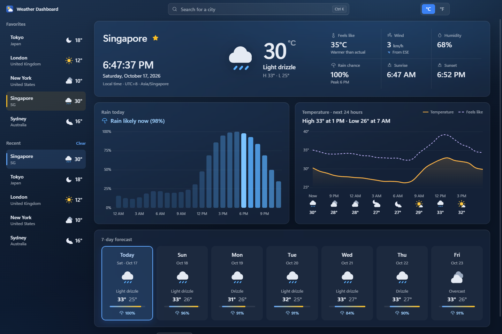

# Weather Dashboard

A dark, modern Windows desktop weather app, written in TypeScript. It's built with Electron, and an Express server inside the app fetches the data. The data comes from [Open-Meteo](https://open-meteo.com/), which is free and needs no API key.



## Features

- **Current conditions:** temperature, feels like, wind (speed and direction), humidity, sunrise and sunset.
- **Live local clock and date for the selected city.** It uses the timezone Open-Meteo returns, not your PC's clock, and shows the UTC offset (for example `UTC+5:45` for Kathmandu).
- **7-day forecast:** each card shows the weekday and date, an icon, the high and low with a weekly range bar, and the chance of rain.
- **Pick any day:** click a day card, or use ←/→, Home and End. The rain and temperature cards switch to that day, and their titles name it ("Rain · Tomorrow, Oct 18"). Today is the default.
- **Rain:** an hourly rain-probability chart plus a one-line summary such as *"Rain likely at 4 PM (70%)"*.
- **Temperature** (Chart.js): the temperature line plus a dashed **feels-like** line, with an hourly strip of icons and temperatures every 3 hours. Today shows the next 24 hours; other days show 12 AM–11 PM.
- **City search** using Open-Meteo geocoding, with keyboard navigation (`Ctrl+K` or `/` to focus, arrow keys, `Enter`).
- **Favorites** (gold accent, like the star) and your **10 most recent cities**, both as cards with live weather.
- **°C / °F toggle** (also switches km/h and mph). It's remembered between launches.
- **Any window size**, down to 480×400. Cards never overlap; a short window scrolls, and a narrow one switches to a single column.
- **Offline-friendly:** if Open-Meteo can't be reached, the app shows the last data it fetched and a banner saying so. A brief Open-Meteo error (5xx) is retried once automatically.
- **Settings panel** (gear in the title bar): a glass sheet that slides down over a frosted backdrop. It's empty for now, and ready for settings to be added (see [Settings panel](#settings-panel)).
- **Accessible:** every chart has a screen-reader data table, and the app follows Windows' "Animation effects" setting.

## Install (for the people you send it to)

1. Run `Weather Dashboard Setup 1.1.0.exe`. If an older version is installed, close the app first; the installer upgrades it and keeps your favorites.
2. The installer isn't code-signed, so Windows SmartScreen may say **"Windows protected your PC"**. Click **More info → Run anyway**. A code-signing certificate would remove this warning; see [Signing](#signing).
3. Pick an install folder. The installer adds Start Menu and desktop shortcuts.

No Node.js or other software is needed: Electron includes its own runtime. Favorites and settings are saved in `%APPDATA%\Weather Dashboard\weather-dashboard.json`. Uninstalling keeps that file; delete the folder to remove it too.

## Measured result: cache hit rate and response time

`npm run bench` replays one realistic session against **live Open-Meteo** (38 requests): open the app, load favorites, search, flip between cities, switch to °F and back, then refresh. Results from 2026-10-17 on this machine (`docs/bench-results.json`):

| | Requests | p50 | p95 |
|---|---:|---:|---:|
| Served from cache | 23 | **0.7 ms** | 1.1 ms |
| Fetched from Open-Meteo | 15 | 46.7 ms | 207.7 ms |

**Cache hit rate: 60.5%.** A cached response is about **69× faster** at the median. The same counters are live at `GET /api/stats` while the app runs. Your numbers will vary with network speed.

The cache keeps weather for 10 minutes and city searches for 24 hours. Coordinates are rounded to about 1 km so the same city always reuses the same entry. Two identical requests made at the same time share one call to Open-Meteo.

## How it works

```
Electron main process (src/main/main.ts)
 ├─ starts Express on 127.0.0.1 with a random free port (never reachable from the network)
 │    ├─ GET  /api/geocode?q=             → Open-Meteo geocoding   (cached 24 h)
 │    ├─ GET  /api/weather?lat&lon&units  → Open-Meteo forecast    (cached 10 min)
 │    ├─ GET  /api/state, PUT/DELETE /api/favorites/:id, POST/DELETE /api/recent, PATCH /api/settings
 │    ├─ GET  /api/stats                  → cache hit rate + response times
 │    └─ static files: the built UI (dist/renderer)
 └─ window loads http://127.0.0.1:<port>
```

**Security choices**
- The window runs with `contextIsolation`, `sandbox` and no Node integration.
- A strict Content Security Policy is applied. All icons and scripts are bundled, with no CDNs.
- Every permission request is denied, and links outside the app open in your browser.
- The server only answers requests whose `Host` is `127.0.0.1` or `localhost`. This blocks DNS-rebinding attacks.
- All text from the API is HTML-escaped before it's shown.
- Request bodies and the JSON file on disk are validated. A corrupt file is backed up and replaced with defaults.

## Why not MongoDB Atlas?

Atlas is a poor fit for an app installed on other people's PCs:

- **The credential would ship to everyone.** The app would need a connection string, and anyone can unpack an Electron app and read it. Every user would get read/write access to your whole database.
- **Private data would leave the user's PC.** One user's favorites and history would land in your shared cloud database, which you'd then have to secure, pay for and maintain.
- **It would need the internet just to show favorites.**

What this app uses instead is a **local JSON file** in each user's own app-data folder. It needs no account and no secrets, works offline, and uninstalls cleanly. Writes are atomic: the app writes a temp file and then renames it over the old one, so a crash can't leave a half-written file. If you later want long-term history (for example, weather logged every hour), **SQLite** is the next step up, still local. A cloud database only makes sense once you add user accounts and a backend *you* host. Then the app talks to your API, never to the database directly.

## Development

Requires **Node.js 22 LTS** (Node 20 reached end-of-life in April 2026).

```bash
npm install
npm run dev          # Vite (hot reload) + Electron
npm run dev:server   # API + Vite only; open http://127.0.0.1:5173 in a browser
npm test             # unit + API tests (Vitest + supertest, no network)
npm run test:e2e     # builds, launches the real Electron app, checks the UI (needs internet)
npm run lint         # ESLint + type-check (main/server, renderer, tests)
npm run bench        # measures cache hit rate and response times (needs internet)
npm run screenshot   # regenerates docs/screenshot.png from the built app
npm run icon         # regenerates build/icon.ico from src/renderer/public/logo.svg
npm run dist         # builds release/Weather Dashboard Setup <version>.exe
```

Configuration: copy `.env.example` to `.env` to change the dev server port or cache lifetimes. There are no secrets anywhere. `.env` is gitignored, and the packaged app uses the defaults.

### Project layout

```
src/
  main/       Electron entry: starts the server, opens a hardened window
  server/     Express app, TTL cache, Open-Meteo client, JSON storage, routes, metrics
  shared/     types, WMO weather codes, timezone-safe time helpers, rain summary (used by server and UI)
  renderer/   UI: HTML/CSS, components, Chart.js charts, inline SVG icons
tests/        Vitest unit/API tests with recorded Open-Meteo fixtures; e2e/ for the app smoke test
scripts/      benchmark, screenshot, icon generator, app launcher for e2e
build/        installer icon
```

### Tests

- **Unit and API (68 tests, offline):**
  - Timezone handling, including UTC+5:45, the date line and DST changes
  - Rain-summary wording, for today and for other days
  - Cache TTL, LRU eviction, stale fallback and request de-duplication
  - JSON storage: corrupt-file recovery, de-duplication, concurrent writes
  - Every API route, with a mocked `fetch` (validation, caching, retry on 5xx, 502 handling)
  - Host-header protection
  - The settings-panel helpers (`settingsRow`, `settingsSection`), in a simulated DOM ([happy-dom](https://github.com/capricorn86/happy-dom))
- **End-to-end (35 tests, 3 files):** launches the built app with a throwaway data folder, with **animations on**, and checks:
  - **The charts really drew data.** It counts canvas pixels in the line and bar colors; just finding the chart elements isn't enough. It also checks the window threw no errors.
  - Tokyo's clock shows UTC+9.
  - The 7 day cards render with dates.
  - Choosing a day by click or keyboard updates the titles, rain line and charts.
  - Recent cities show as weather cards, and starring a city writes it to the JSON file.
  - The °F toggle works.
  - **Layout:** the window is really resized to 1360×900, 1000×700, 800×600, 500×900 and 1000×450, and also maximized then restored. At each size: no cards overlap, nothing sits outside its card, there's no horizontal scroll, and short windows scroll.
  - **Settings panel**, with real mouse clicks and key presses:
    - The gear opens a labelled modal dialog and focus moves inside it.
    - Tab and Shift+Tab stay inside it.
    - Escape, an outside click and the close button each close it, and focus returns to the gear.
    - The computed `backdrop-filter` blur is applied.
    - It fits at every window size above.
    - With reduced motion it appears without animation.
    - The clock and charts keep working while it's open.

  The tests drive the app over the Chrome DevTools Protocol: the window through Chromium's debugging port, and window resizing through Electron's main-process inspector. No test-only code ships in the app.

### Settings panel

The gear in the title bar opens a glass sheet that slides down over a frosted backdrop. It's empty in this version. Sections live in one list in `src/renderer/components/settings.ts`, and two helpers build accessible markup. To add one:

```ts
// src/renderer/components/settings.ts
const compact = document.createElement('input');
compact.type = 'checkbox';

export const SETTINGS_SECTIONS: SettingsSection[] = [
  {
    id: 'display',
    title: 'Display',
    render: (body) => body.append(settingsRow({ label: 'Compact cards', description: 'Smaller forecast cards.', control: compact })),
  },
];
```

- `settingsRow` connects the label and description to the control (`for`, `aria-describedby`).
- `settingsSection` adds the heading.
- The panel takes care of scrolling, the focus trap and closing.
- To save a value between launches, add it to `Settings` in `src/shared/types.ts`, accept it in `PATCH /api/settings` (`src/server/routes/state.ts` and `storage.ts`), and call `api.saveSettings({ ... })` from the control's `change` handler.

### Signing

To remove the SmartScreen warning, buy a code-signing certificate (an OV/EV certificate, or Azure Trusted Signing). Then set `CSC_LINK` / `CSC_KEY_PASSWORD` as environment variables before `npm run dist`; electron-builder signs automatically. Never commit the certificate.

## Credits

Weather data by [Open-Meteo.com](https://open-meteo.com/) (CC BY 4.0).

## License

MIT. See [LICENSE](LICENSE).
