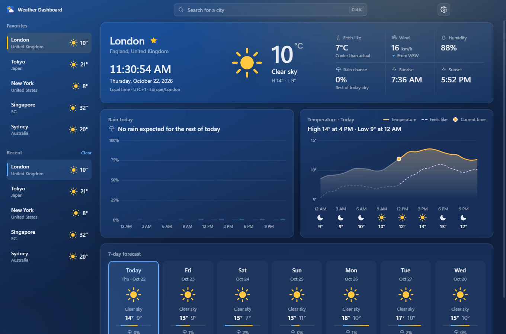
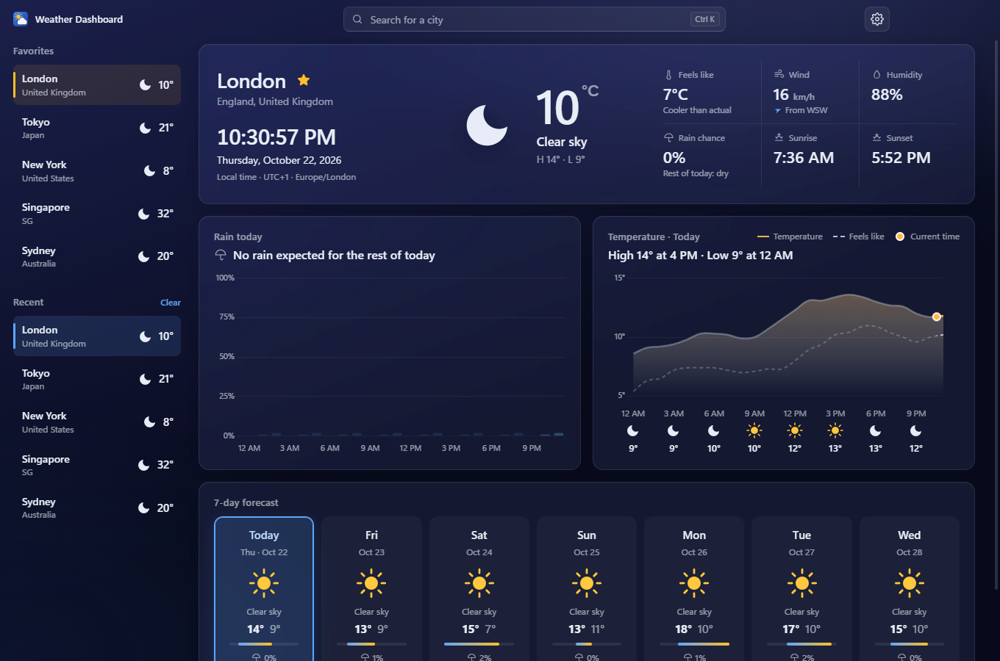
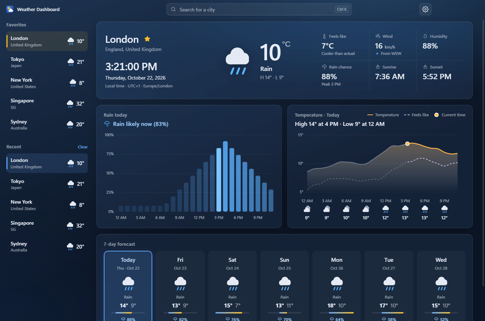

<div align="center">

# 🌦️ Weather Dashboard

**A dark, modern Windows desktop weather app: live conditions, a 7-day forecast, rain and temperature charts, and favorite cities. Built with Electron, Express and TypeScript.**


|  |  |  |
|:---:|:---:|:---:|
| Clear day | Night | Rain |

</div>

---

## 💡 Why this project exists

Most weather apps are cluttered, full of ads, or need an account. I wanted one clean window that answers the questions I actually have: what is it like now, will it rain today, and what does the week look like, for any city I care about.

It is also **project #2** of my build plan. The goal was to ship something real: not a script, but an app that installs on another person's PC, works offline, and has tests.

## 🔎 What it does

- **Current conditions:** temperature, feels like, wind, humidity, sunrise and sunset.
- **Live local clock** for the selected city, using that city's own timezone (for example `UTC+5:45` for Kathmandu).
- **7-day forecast:** click a day (or use ←/→) and the rain and temperature charts switch to it.
- **Rain chart** with a one-line summary such as *"Rain likely at 4 PM (70%)"* (or *"16:00"* in 24-hour mode).
- **Temperature chart** with a dashed feels-like line and an hourly icon strip.
- **City search** with keyboard shortcuts (`Ctrl+K` or `/`).
- **Favorites and recent cities**, shown as cards with live weather.
- **Settings panel (v1.2):** a full-window liquid-glass panel with temperature (°C/°F) and wind-speed units (km/h, mph, m/s) and a 12-hour or 24-hour clock that updates everywhere at once.
- **Live data and chart (v1.3):** refreshes itself every 5 minutes with no flicker, and the temperature chart covers the whole day (12 AM to 11 PM in the city's own time): hours that have passed are grey, the rest is coloured, and a dot marks the current time with a "Now" label right under it. The hourly strip is evenly spaced and can show every 3 hours, every 2 hours or every hour.
- **Works at any window size**, down to 480×400.
- **Offline-friendly:** if the internet drops, it shows the last data it fetched and says so.
- **Accessible:** every chart has a screen-reader data table.

Weather data comes from [Open-Meteo](https://open-meteo.com/), which is free and needs no API key.

### 📊 Measured result: the cache really helps

`npm run bench` replays one realistic session (38 requests) against live Open-Meteo:

| | Requests | Median | 95th percentile |
|---|---:|---:|---:|
| Served from cache | 23 | **0.7 ms** | 1.1 ms |
| Fetched from Open-Meteo | 15 | 46.7 ms | 207.7 ms |

**Cache hit rate: 60.5%.** A cached answer is about **69× faster**. Your numbers will vary with your network.

## ⚙️ Setup

### Just want to use it?

1. Run `Weather Dashboard Setup 1.1.0.exe` (from the GitHub release).
2. Windows may say **"Windows protected your PC"** because the installer is not code-signed. Click **More info → Run anyway**.
3. Pick an install folder. You get Start Menu and desktop shortcuts.

No Node.js needed. Favorites and settings are saved in `%APPDATA%\Weather Dashboard\weather-dashboard.json`.

### Want to run it from the code?

You need **Node.js 22 LTS**.

```bash
git clone https://github.com/MooreHaww/weather-dashboard.git
cd weather-dashboard
npm install
npm run dev
```

| Command | What it does |
|---|---|
| `npm run dev` | Vite (hot reload) + Electron |
| `npm run dev:server` | API + Vite only, open `http://127.0.0.1:5173` in a browser |
| `npm test` | Unit and API tests (128 tests, no internet needed) |
| `npm run test:e2e` | Launches the real app and checks the UI (117 tests, needs internet) |
| `npm run lint` | ESLint and type-check |
| `npm run bench` | Cache hit rate and response times |
| `npm run dist` | Builds the Windows installer |

There are no secrets anywhere. Copy `.env.example` to `.env` only if you want to change the dev port or cache times.

## 🎯 What I wanted to learn

- How to build a **desktop app with Electron** and package it into a real installer.
- How to put a small **Express server inside the app** so the UI talks to a clean local API.
- How to write a **cache** (10-minute TTL for weather, 24 hours for city search) and prove it with numbers instead of guessing.
- How to deal with **time zones** properly: the clock must follow the city, not my PC.
- How to **test a GUI app end to end**, including checking that the charts actually drew pixels.
- How to make an Electron app **secure** and **accessible**.
- Why a **local JSON file** beats a cloud database for an app that other people install.

## ⚙️ Settings panel

The gear in the title bar opens a liquid-glass panel that covers the whole window: the dashboard behind it stays visible but frosted. `Esc`, the close button (in the gear's spot) or the gear itself closes it, and keyboard focus stays inside while it is open. Its content scrolls when the window is short. With "reduce animations" on in Windows it fades instead of sliding.

| Section | Options |
|---|---|
| **Units** | Temperature °C / °F, wind speed km/h / mph / m/s |
| **Time format** | 12-hour or 24-hour, shown with examples from the current time (for example "12-hour (4:00 PM)" and "24-hour (16:00)"); used by the live clock, hourly strip, chart labels, sunrise and sunset, and the rain line |
| **Temperature chart** | Time labels under the temperature chart: every 3 hours (default), every 2 hours, or every hour. A narrow card shows fewer, evenly spaced |

Settings are saved in the local JSON file and checked by the server; older files without the new fields load with the defaults (12-hour, km/h, every 3 hours). Sections are plain data in `SETTINGS_SECTIONS` (`src/renderer/components/settings.ts`), built with `settingsRow` and `segmentedControl`. Later releases add their own sections (startup, close behavior, widget) the same way. Every time on screen goes through one function, `formatTime` in `src/shared/time.ts`.

## 🏗️ How it was built

```text
Electron main process
 ├─ starts Express on 127.0.0.1 (random free port, never reachable from the network)
 │    ├─ /api/geocode   → Open-Meteo geocoding   (cached 24 h)
 │    ├─ /api/weather   → Open-Meteo forecast    (cached 10 min)
 │    ├─ /api/state, /api/favorites, /api/recent, /api/settings
 │    ├─ /api/stats     → cache hit rate and response times
 │    └─ the built UI
 └─ the window loads http://127.0.0.1:<port>
```

| Folder | Purpose |
|---|---|
| `src/main/` | Electron entry: starts the server, opens a hardened window |
| `src/server/` | Express app, cache, Open-Meteo client, JSON storage, routes |
| `src/shared/` | Types, weather codes, time helpers (used by server and UI) |
| `src/renderer/` | The UI: HTML/CSS, components, Chart.js charts, SVG icons |
| `tests/` | Vitest unit/API tests and the end-to-end tests |
| `scripts/` | Benchmark, screenshot and icon tools |

**Key decisions**

- **Local JSON file, not MongoDB Atlas.** A cloud database needs a connection string, and anyone can unpack an Electron app and read it. It would also send each user's private data to a shared database and need internet just to show favorites. A local file needs no account, works offline and uninstalls cleanly. Writes are atomic, so a crash cannot leave a half-written file.
- **Security.** The window runs sandboxed with context isolation and no Node access. A strict Content Security Policy blocks outside scripts. The server only answers requests addressed to `127.0.0.1` or `localhost` (this blocks DNS-rebinding attacks). All API text is HTML-escaped.
- **Cache.** Coordinates are rounded to about 1 km so the same city always reuses one entry, and two identical simultaneous requests share one call to Open-Meteo.

**Build order**

1. Express server and Open-Meteo client with the cache.
2. UI, charts and the 7-day forecast.
3. Favorites, recent cities, units and local storage.
4. Electron wrapper and security hardening.
5. Unit, API and end-to-end tests.
6. Benchmark, installer, and the v1.1 fixes after testing it myself.

## 🗺️ Roadmap

### v1.0
- [x] Current weather with a live clock in the city's own timezone
- [x] 7-day forecast, rain and temperature charts
- [x] City search, favorites, recent cities, °C/°F
- [x] Offline fallback and cache with a measured hit rate
- [x] Windows installer

#### v1.0 (Fixes)
- [x] Fix the empty rain and temperature charts
- [x] Fix cards overlapping when the window is resized or docked
- [x] Fix day cards not clickable

### v1.1
- [x] Selectable days in the 7-day forecast
- [x] Temperature box with feels-like and hourly icons
- [x] Bigger refresh button
- [x] Recent cities as full cards, favorites with a gold bar
- [x] Stats without boxes
- [x] Empty settings sheet
- [x] 103 automated tests, MIT license
- [x] v1.1.0 released

#### v1.1 (Fixes)
- [x] One automatic retry when Open-Meteo returns a server error

### v1.2 - Settings
- [x] Settings overhaul: turn the settings sheet into a full-screen liquid-glass panel that blurs everything behind it
- [x] A settings page for units, startup, close behavior and widget options
- [x] An option for 12 am/pm format and 24 one

#### v1.2 (Fixes)
- [x] Remove the duplicate °C/°F toggle from the title bar
- [x] Fix the missing divider lines in the narrow layout

### v1.3 - Live data and chart
- [x] Refresh / update every 5m by itself
- [x] Make the temperature box cover all 24h of the day; the time that has passed has no colours in it, plus a dot to show the time we are in
- [x] Choose how detailed the temperature box times are: every 3 hours, every 2 hours, or every hour
- [x] Clear 12-hour / 24-hour choice with examples

#### v1.3 (Fixes)
- [x] Hourly labels evenly spaced, no empty gaps
- [x] Removed the "Now" label; the dot pulses and the legend says "Current time"

### v1.4 - Auto-update
- [ ] Auto-update through GitHub Releases

#### v1.4 (Fixes)

### v1.5 - Location
- [ ] Auto-detect my location on first launch
- [ ] Add (your location) and it stays on top

#### v1.5 (Fixes)

### v1.6 - Liquid glass look
- [ ] Make the full background 100% liquid glass with blur, and anything that needs a box gets extra blur behind it

#### v1.6 (Fixes)

### v1.7 - Background mode
- [ ] Close-button choice: exit completely, or keep running in the background (which keeps the widget alive)
- [ ] Start with Windows: option to launch the app on PC startup
- [ ] Tray icon that shows the current temperature

#### v1.7 (Fixes)

### v1.8 - Rain alerts
- [ ] Rain alerts, e.g. a notification "Rain starting in about 30 minutes"

#### v1.8 (Fixes)

### v1.9 - Desktop widget
- [ ] Desktop widget: an option in the app to add a weather widget to the Windows desktop

#### v1.9 (Fixes)

### v2.0 - History
- [ ] Optional long-term history (SQLite, still local)

#### v2.0 (Fixes)

### Later
- [ ] More themes (still an idea)

## 📄 Notes

Weather data by [Open-Meteo.com](https://open-meteo.com/) (CC BY 4.0). Released under the MIT license, see [LICENSE](LICENSE).